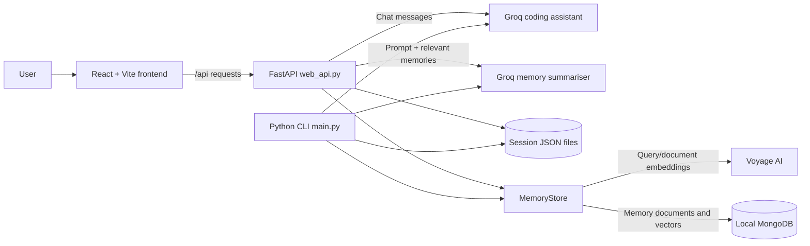

# System Documentation

## 1. Purpose

This project is a coding assistant with two interfaces: a Python command-line app and a React + Vite web app. LangChain connects the application to Groq chat models. A separate summariser call extracts durable facts from each user prompt, while Voyage AI creates embeddings for those facts. MongoDB stores long-term memories so they can be retrieved in later sessions.

The application has two persistence layers:

- **Session history:** JSON files in `sessions/`, containing the messages for each conversation.
- **Long-term memory:** MongoDB documents shared across sessions and retrieved by semantic similarity.

`memory.txt` is no longer used. MongoDB is the only active long-term memory store.

### Key Concepts

- **Session history** is the detailed conversation transcript used to continue one chat. It is separate from long-term memory.
- **Long-term memory** is a small set of durable facts selected by the summariser; it is shared across sessions and is not a copy of the full chat history.
- **Retrieval-augmented generation (RAG)** means searching for relevant saved facts and adding them to the model's prompt at request time. The models are not fine-tuned and their weights are not changed by saved memories.
- **Embeddings** are numeric vectors representing text. MongoDB Vector Search compares a prompt vector against indexed memory vectors to retrieve related memories even when wording differs.
- **Time to live (TTL)** is a MongoDB expiration rule driven by a date field. It provides automatic cleanup after the configured retention period.

## 2. High-Level Architecture



### Responsibilities

| Component | Responsibility |
| --- | --- |
| `main.py` | CLI menu, session handling, system prompts, memory type validation, and CLI model calls. |
| `web_api.py` | FastAPI lifecycle, browser-facing endpoints, and web request orchestration. It imports prompts and session helpers from `main.py`. |
| `memory_store.py` | Connects to MongoDB, creates indexes, embeds saved memories, searches vectors, and updates memory documents. |
| `frontend/` | React interface for session navigation, chat, Markdown/code display, and the latest memory update. |
| `sessions/` | JSON transcript files; one per session. |
| MongoDB `memories` collection | Shared long-term memory records, embeddings, provenance, and expiry. |
| Groq | Generates coding responses and summariser output. |
| Voyage AI | Converts each memory and each retrieval query into vectors. |

## 3. Chat Request Lifecycle

For a normal chat turn, both the CLI and web API follow the same main process:

1. Read the user's prompt and the current session history.
2. Retrieve up to eight relevant, unexpired MongoDB memories using vector similarity.
3. Add those memories to the coding assistant's system prompt.
4. Send the current session history and new prompt to the Groq coding model.
5. Save the user prompt and coding response to that session's JSON file.
6. Send the same relevant memory subset and latest user prompt to the Groq summariser.
7. Validate the summariser's JSON, embed each returned memory, and update MongoDB.
8. Show the coding response followed by the summariser result (in the CLI, or as a memory update panel in the web UI).

The coding assistant uses the default Groq model `openai/gpt-oss-120b` with temperature `0.2`. The summariser uses the same configured model with temperature `0` to favor consistent structured output.

If `SUMMARIZER_ONLY=true`, coding model calls are skipped but the summariser and memory update still run. In this mode the CLI does not add the prompt to its chat transcript; the web API records the prompt as a user-only session message.

## 4. Sessions and Chat History

Each session is stored as `sessions/<session_id>.json`. The ID is eight hexadecimal characters generated from a UUID. A new file begins with this structure:

```json
{
  "created_at": "ISO-8601 local timestamp",
  "messages": []
}
```

Normal assistant conversations append messages in alternating user/assistant form:

```json
{
  "role": "user",
  "content": "The user's message"
}
```

```json
{
  "role": "assistant",
  "content": "The coding assistant's response"
}
```

When a session is resumed, `main.py` or `web_api.py` converts the saved roles into LangChain `HumanMessage` and `AIMessage` objects. A fresh system message is added for each request, including the memories retrieved for that specific prompt. Summariser output is not persisted as a chat message.

## 5. Summariser and Memory Types

The summariser receives:

- Up to eight semantically relevant existing memories as JSON objects containing `type` and `content`.
- The latest user message.
- A system prompt that defines durable memory rules, allowed types, and the required output schema.

It must return valid JSON with this structure:

```json
{
  "memories": [
    {
      "type": "project_fact",
      "content": "A concise, self-contained durable fact."
    }
  ]
}
```

Allowed memory types:

- `project_fact` - confirmed facts about a project.
- `technical_decision` - explicit technical or architectural choices.
- `business_rule` - functional, security, or validation constraints.
- `user_preference` - stable preferences supported by evidence.
- `lesson_learned` - verified outcomes from implementation or debugging.
- `ongoing_goal` - planned or active objectives, with their status where relevant.
- `project_milestone` - verified completed achievements.

`parse_memories()` in `main.py` rejects malformed JSON, unknown types, extra fields, and empty content before MongoDB is changed. Markdown JSON fences are stripped before parsing when present.

## 6. Long-Term Memory Storage

### MongoDB connection and indexes

Defaults are:

- URI: `mongodb://localhost:27017`
- Database: `agentic_memory`
- Collection: `memories`

At startup, `MemoryStore` pings MongoDB and creates:

- A TTL index on `expires_at` with `expireAfterSeconds=0`.
- A unique index on `memory_key`.
- A MongoDB Vector Search index on `embedding` using cosine similarity, with `expires_at`, `source`, `type`, and `created_at` indexed as filter fields.

The app waits for the updated vector index definition to be active on all search nodes before starting. The MongoDB TTL monitor removes expired records asynchronously. Retrieval always filters out expired records and can additionally pre-filter by selected source sessions, memory types, and creation date.

Memory retention is set by type and refreshed on each successful save:

| Memory type | TTL |
| --- | ---: |
| `project_fact` | 365 days |
| `technical_decision`, `business_rule`, `ongoing_goal` | 180 days |
| `user_preference`, `lesson_learned`, `project_milestone` | 30 days |

On the first startup after this policy is introduced, existing records have `expires_at` recalculated from `updated_at`, falling back to `created_at`. A `ttl_policy_version` field prevents this migration from running again on later startups. Expired records are then removed asynchronously by MongoDB's TTL monitor.

### Memory document

A stored document has this conceptual shape:

```json
{
  "memory_key": "SHA-256 hash of the memory type and content",
  "type": "project_fact",
  "content": "The original concise memory text.",
  "embedding": [0.12, -0.04, 0.08],
  "source": "session_id",
  "created_at": "UTC timestamp",
  "updated_at": "UTC timestamp",
  "expires_at": "UTC timestamp",
  "ttl_policy_version": 1
}
```

The vector shown is abbreviated. `memory_key` is the SHA-256 hash of the JSON-encoded pair `[type, content]`. The `source` is set when the record is first inserted; subsequent updates refresh `updated_at` and `expires_at` but do not change `source` or `created_at`.

Each returned memory's `content` is an independent input in a batched Voyage request; `type` remains MongoDB metadata and is not included in the embedding text. The Voyage client retries transient rate-limit errors. The configured output dimension must match the vector index dimension. Each upsert refreshes expiry using the TTL for that memory's type.

## 7. Vector Retrieval

Retrieval is performed by MongoDB Vector Search. Python creates the query vector, then runs an aggregation pipeline whose first stage is `$vectorSearch`:

1. Voyage embeds the current user prompt with `input_type="query"` and `output_dimension=VOYAGE_DIMENSIONS`.
2. MongoDB compares the query vector with the indexed `embedding` field using cosine similarity.
3. `$vectorSearch.filter` always excludes expired records using `expires_at` and optionally filters by selected `source`, `type`, and `created_at` date range. The recency window is measured from the memory's original creation date, not from later refreshes.
4. The stage returns up to eight matches. The app requests at least 20 candidates per result (`numCandidates=max(100, limit * 20)`) to improve approximate-nearest-neighbor recall.

The web UI offers multi-select dropdowns for conversations and the seven permitted memory types. Its recency dropdown provides forever (the default), 1, 7, 14, and 30 days, plus a custom number of days. An empty source or type selection means all. The selected records are shared by the coding assistant and summariser; records outside the retrieved subset remain untouched when memories are updated.

The same selected records are used by the coding assistant and summariser. The coding assistant receives text formatted as `- [type] content`. The summariser receives JSON containing the selected records' `type` and `content` fields. Python does not scan or rank the stored embeddings; the database's `$vectorSearch` stage performs retrieval.

The current query uses approximate nearest neighbor (ANN) search and has no minimum score threshold. It returns the closest matches available up to the limit, even when all scores are low. MongoDB requires a compatible Vector Search deployment, an indexed vector field, and its `mongot` search process. A standalone MongoDB server without `mongot` cannot execute this query; self-managed `mongot` requires a replica set. On Windows, MongoDB recommends a Docker-based Atlas Local deployment because native Windows `mongot` binaries are unavailable. See [MongoDB's local development quickstart](https://www.mongodb.com/docs/search/self-managed/current/installation/quick-start/) and [self-managed platform limitations](https://www.mongodb.com/docs/search/self-managed/current/limitations/).

The local MongoDB service inspected for this project reports version `8.2.1`, is configured as a standalone server, and has no `mongot` process running. It cannot run this application's native vector search as currently configured. On this Windows machine, use Atlas or Docker-based Atlas Local. If the existing local database contains memories, they must be migrated to the search-enabled deployment to make them available there.

For Atlas Free M0, if index creation from PyMongo is unavailable, create a Vector Search index in the Atlas UI with this definition and the name `memory_vector_index`:

```json
{
  "fields": [
    {
      "type": "vector",
      "path": "embedding",
      "numDimensions": 1024,
      "similarity": "cosine"
    },
    {
      "type": "filter",
      "path": "expires_at"
    },
    {
      "type": "filter",
      "path": "source"
    },
    {
      "type": "filter",
      "path": "type"
    },
    {
      "type": "filter",
      "path": "created_at"
    }
  ]
}
```

## 8. Memory Update Semantics

The summariser is given a relevant subset, not the complete MongoDB collection. Its output is treated as the updated set for that subset:

- Returned memories are individually embedded and upserted using their memory keys.
- Retrieved records omitted from the returned set are deleted.
- Records that were not retrieved remain untouched in MongoDB.
- An unchanged record has the same key and is updated in place. A changed type or content normally produces a new key; the old retrieved key is then retired if it was omitted.

Embeddings are created before the MongoDB upserts. Writes happen sequentially and are not wrapped in a MongoDB transaction, so a database failure during saving may leave earlier upserts completed. Errors from summarising or saving are reported separately from a successful coding response in the web API.

## 9. Web Application and API

The React + Vite development server runs on port `5173` by default and proxies `/api` requests to the FastAPI server at `127.0.0.1:8000`. FastAPI also allows the local Vite origins in its CORS configuration.

| Method | Endpoint | Purpose |
| --- | --- | --- |
| `GET` | `/api/status` | Reports summariser-only mode and the permitted memory types. |
| `GET` | `/api/sessions` | Lists saved sessions, titles, and message counts. |
| `POST` | `/api/sessions` | Creates a new session. |
| `GET` | `/api/sessions/{session_id}` | Loads a session and its messages. |
| `POST` | `/api/sessions/{session_id}/messages` | Retrieves filtered memory, calls the configured agents, and persists the turn. Accepts optional `memory_filters` with `sources`, `types`, and `recency_days`; empty source/type lists and `null` recency mean all/forever. |

The message endpoint accepts `{"content":"user prompt"}`. Its response includes `assistant_reply` (or `null` in summariser-only mode), `summarizer_output` (the raw JSON text or `null`), `memory_error` (or `null`), the saved `messages`, and a `summarizer_only` flag. A coding model failure returns HTTP 502. A summariser or memory-save failure is reported in `memory_error` so an already-generated coding reply can still be returned.

Session IDs are validated as eight lowercase hexadecimal characters before a session path is opened. The chat endpoint limits prompt content to 20,000 characters. The API has no user authentication and is intended for local development; Uvicorn's default binding is localhost unless configured otherwise.

The frontend renders coding responses as Markdown, including tables and fenced code blocks. It displays the latest summariser result in an expandable memory panel. Session messages persist across browser reloads; the latest summariser panel itself is not stored in session history.

### Data sent to external services

Session files and MongoDB memory records are stored locally with the default configuration. The current prompt and saved session history, plus selected long-term memories, are sent to Groq for coding and summarising. A user's prompt is sent to Voyage to create a query vector when active memories exist; each returned memory's content is sent to Voyage to create its document vector. API credentials remain in the Python process's `.env` configuration and are not exposed in the React bundle.

## 10. Configuration and Dependencies

Configuration is read from `.env` by both the CLI and web API. `.env` is ignored by Git; use `.env.example` as a template and do not commit credentials.

| Variable | Default | Purpose |
| --- | --- | --- |
| `GROQ_API_KEY` | none | Required credential for Groq chat calls. |
| `GROQ_MODEL` | `openai/gpt-oss-120b` | Model used for coding and summarising. |
| `SUMMARIZER_ONLY` | `false` | Skips coding responses when true. |
| `VOYAGE_API_KEY` | none | Required credential for Voyage embeddings. |
| `VOYAGE_MODEL` | `voyage-4-lite` | Embedding model for documents and queries. |
| `VOYAGE_DIMENSIONS` | `1024` | Embedding output dimension and MongoDB vector index dimension. |
| `MONGODB_URI` | unset (code fallback: `mongodb://localhost:27017`) | MongoDB connection string. Use a compatible Atlas cluster for hosted Vector Search. |
| `MONGODB_DATABASE` | `agentic_memory` | Database name. |

Python dependencies are declared in `requirements.txt`. The frontend uses React, React DOM, React Markdown, Remark GFM, Vite, and the Vite React plugin; versions are declared in `frontend/package.json`.

## 11. Running Locally

Start a MongoDB deployment that supports MongoDB Vector Search. A default Windows MongoDB service is not enough unless a compatible `mongot` search process is configured. From the project root, create the Python environment and install dependencies:

```powershell
python -m venv .venv
.\.venv\Scripts\Activate.ps1
python -m pip install -r requirements.txt
```

Create `.env` from `.env.example` if needed and set the Groq and Voyage credentials. Run either interface:

**CLI**

```powershell
python main.py
```

**Web app** - start the API in one terminal:

```powershell
uvicorn web_api:app --reload
```

Then start Vite in another terminal:

```powershell
cd frontend
npm install
npm run dev
```

Open the local URL printed by Vite, usually `http://localhost:5173`. If `SUMMARIZER_ONLY=true`, the interface runs without coding responses; set it to `false` and restart the process to re-enable the coding model.

## 12. Current Boundaries

- Session history is stored as local JSON files; long-term memory is stored in MongoDB.
- Retrieval uses MongoDB `$vectorSearch` with approximate nearest-neighbor search; it requires the vector index and compatible `mongot` deployment to be available.
- The summariser only sees the top-eight relevant memory subset. A forget/update request can only directly affect records included in that subset.
- A separate summariser result is returned/displayed but is not persisted as a transcript message.
- The project has not yet been built or integration-tested in this workspace. Install the declared dependencies before running either interface.
